# Miso Chat

       

Miso Chat is a roleplay chat app that talks to Gemini, with optional DeepSeek, local OpenAI-style server and Claude Code backends. It is a FastAPI web app for several accounts: each account has its own chat history, memory and persona choice, and the admin manages accounts, usage caps, token budgets, providers, character cards and icons, and a stats page.

This is a personal project. It is built for use on one machine or a private network. It is not hardened for the open internet. See Security below.

## Screenshots

The pictures use seven made-up characters and made-up chats. They show no real account, character or data. The characters have no backgrounds of their own, so each picture shows the default backgrounds for its look.

Miso Chat has four looks, chosen under Settings, Appearance, Theme: Moonlit (the default), Soft Shadows, Dusk and Hyacinth (1.4.1). The pictures show every look on desktop and on a phone.

Desktop, home page, all four looks:

<table>
  <tr>
    <td align="center">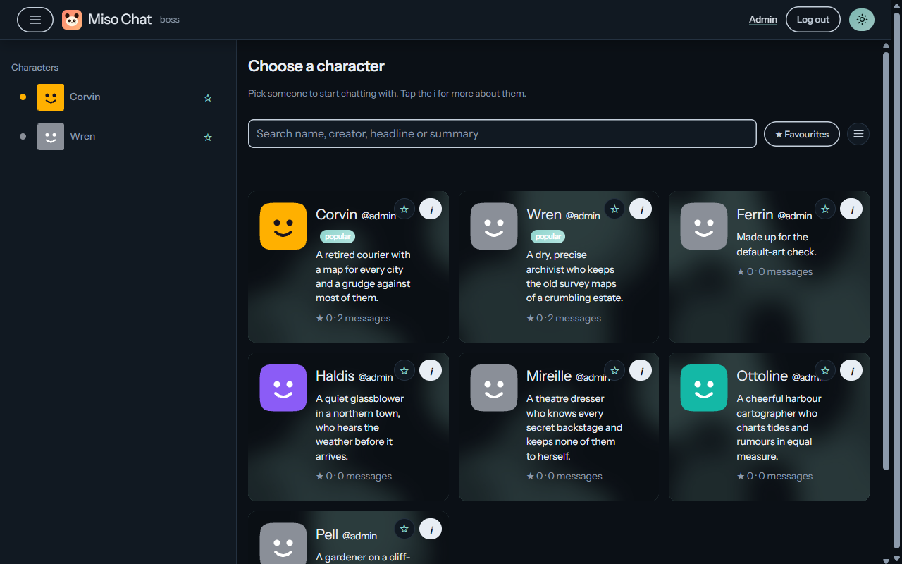 Moonlit (default): home</td>
    <td align="center">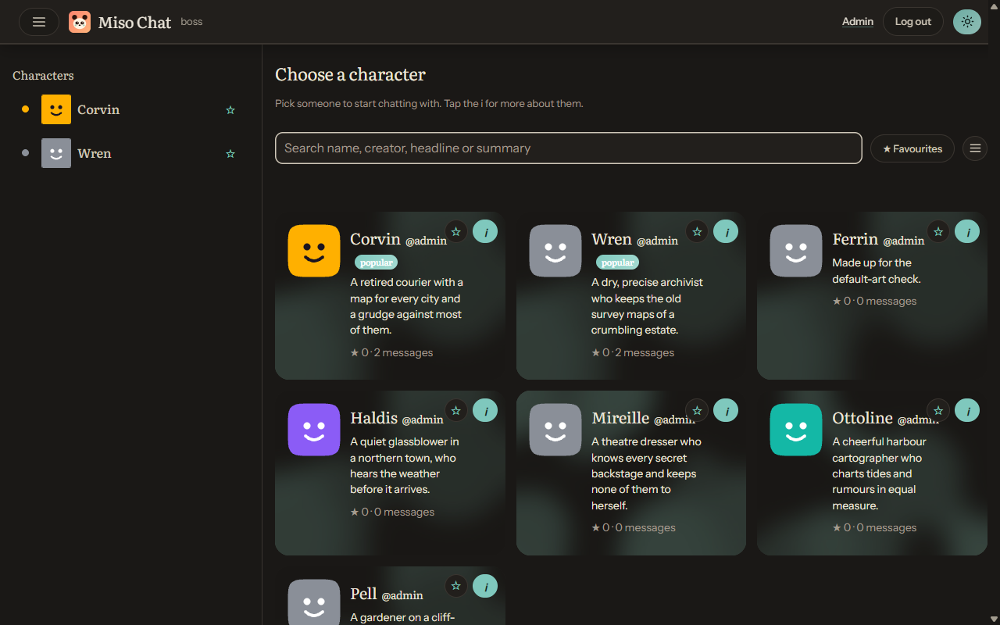 Soft Shadows: home</td>
  </tr>
  <tr>
    <td align="center">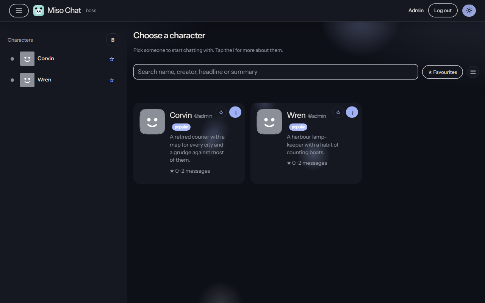 Dusk: home</td>
    <td align="center">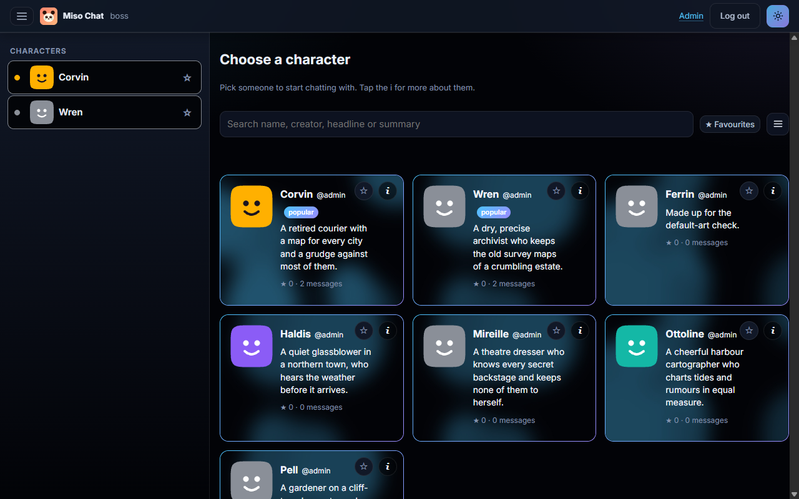 Hyacinth (1.4.1): home</td>
  </tr>
</table>

Desktop, a chat, all four looks:

<table>
  <tr>
    <td align="center">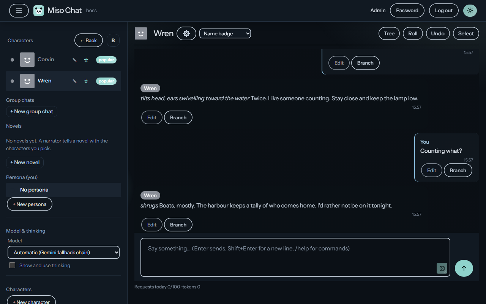 Moonlit (default): a chat</td>
    <td align="center">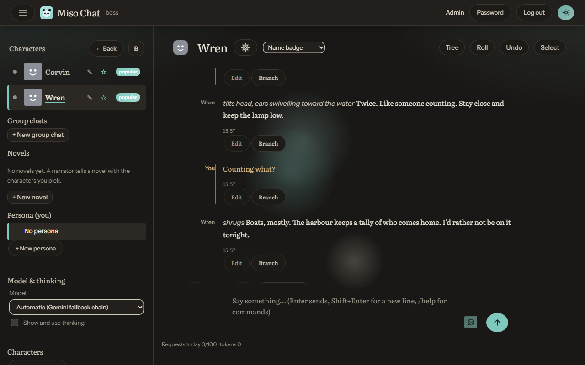 Soft Shadows: a chat</td>
  </tr>
  <tr>
    <td align="center">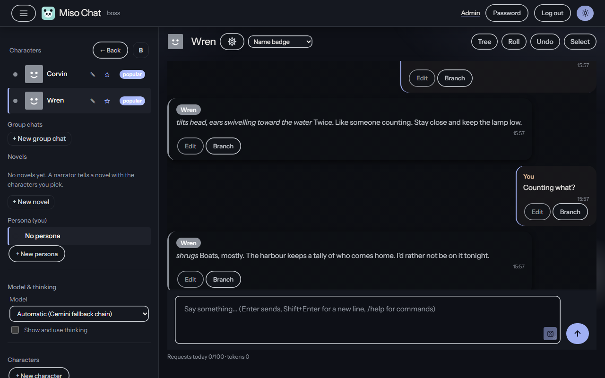 Dusk: a chat</td>
    <td align="center">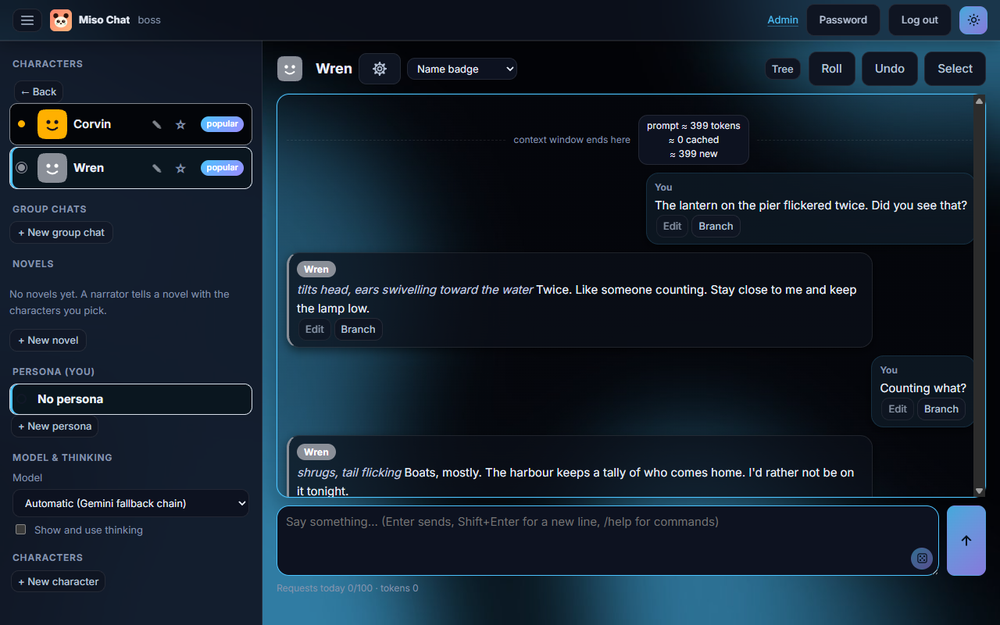 Hyacinth (1.4.1): a chat</td>
  </tr>
</table>

Phone, home, all four looks (left to right: Moonlit, Soft Shadows, Dusk, Hyacinth):

<table>
  <tr>
    <td align="center">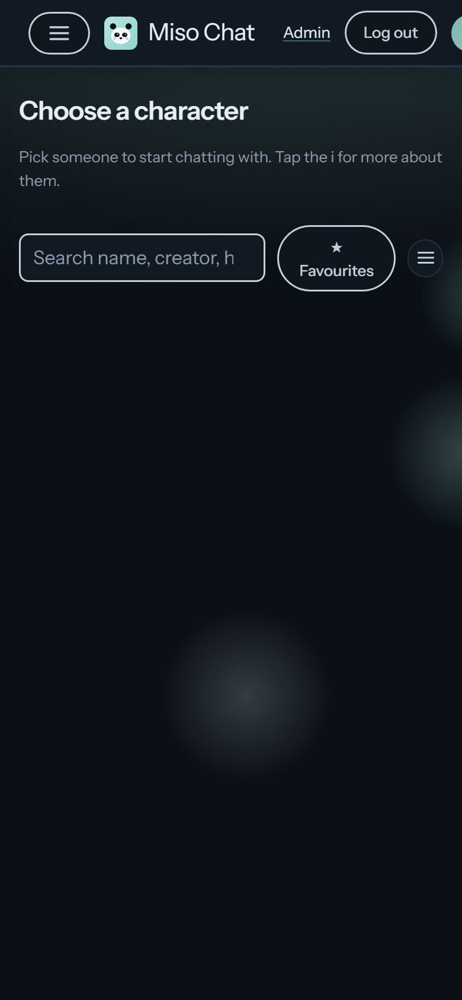 Moonlit (default): home</td>
    <td align="center">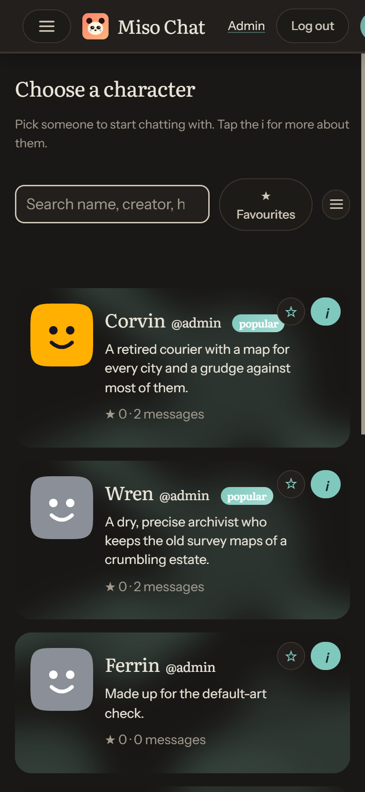 Soft Shadows: home</td>
    <td align="center">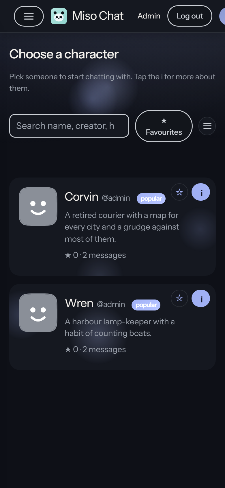 Dusk: home</td>
    <td align="center">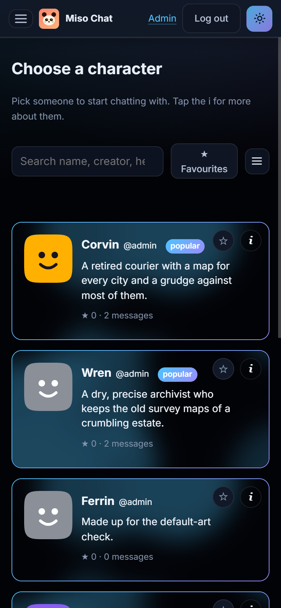 Hyacinth (1.4.1): home</td>
  </tr>
</table>

Phone, a chat, all four looks (same order):

<table>
  <tr>
    <td align="center">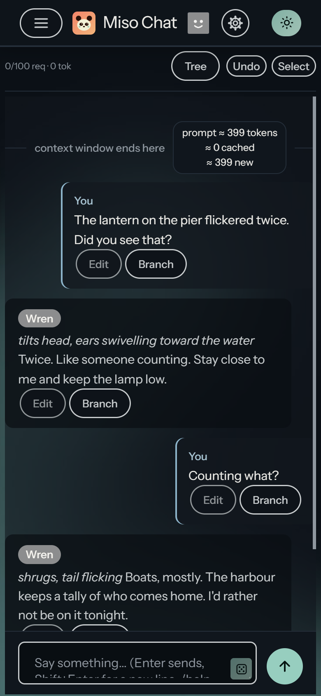 Moonlit (default): chat</td>
    <td align="center">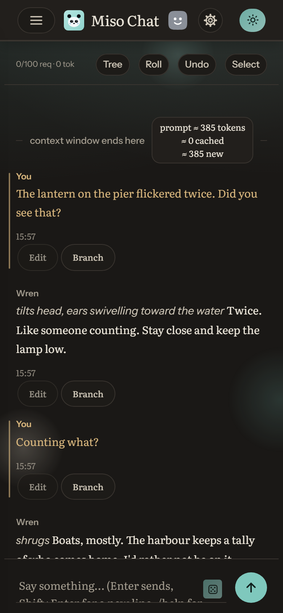 Soft Shadows: chat</td>
    <td align="center">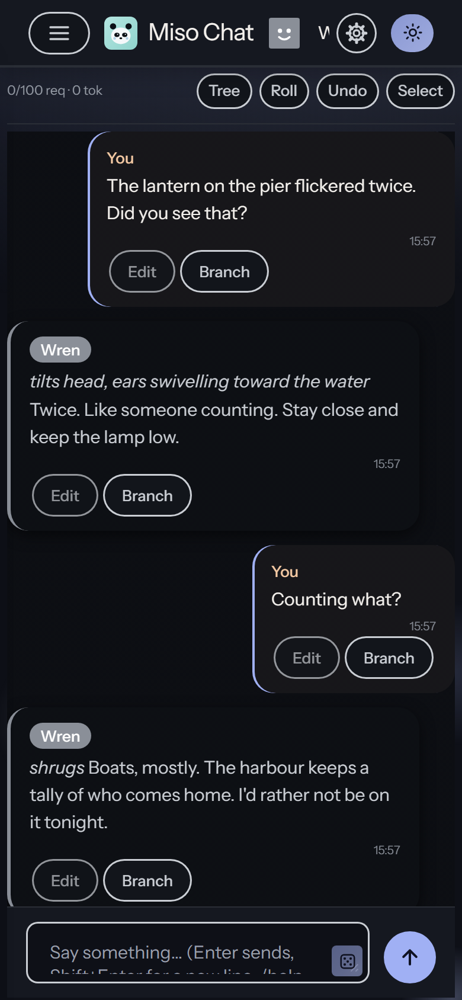 Dusk: chat</td>
    <td align="center">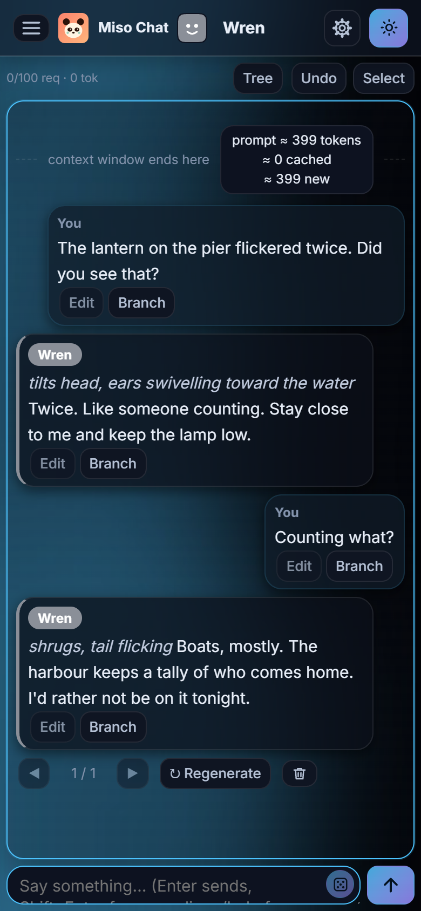 Hyacinth (1.4.1): chat</td>
  </tr>
</table>

Moonlit, the default look, on desktop:

<table>
  <tr>
    <td align="center">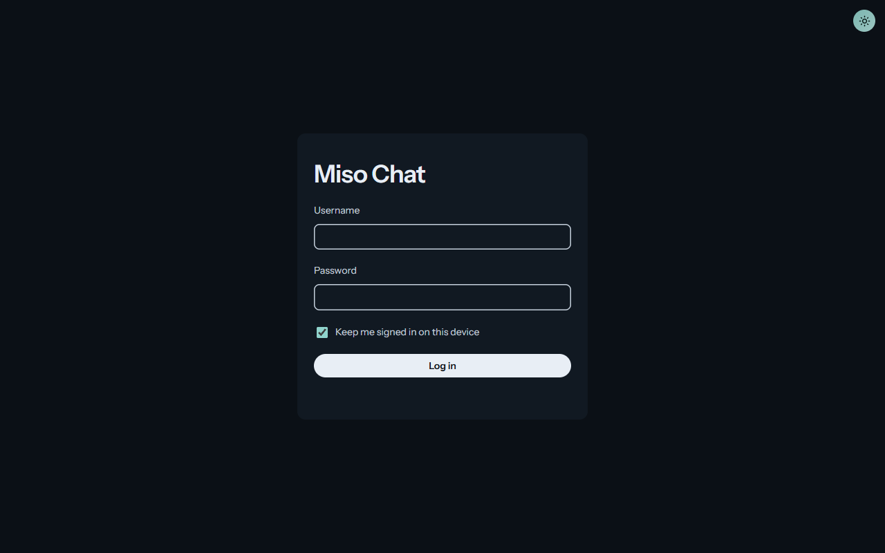 Moonlit: sign in</td>
    <td align="center"> Moonlit: home page</td>
  </tr>
  <tr>
    <td align="center"> Moonlit: a chat on desktop</td>
    <td align="center">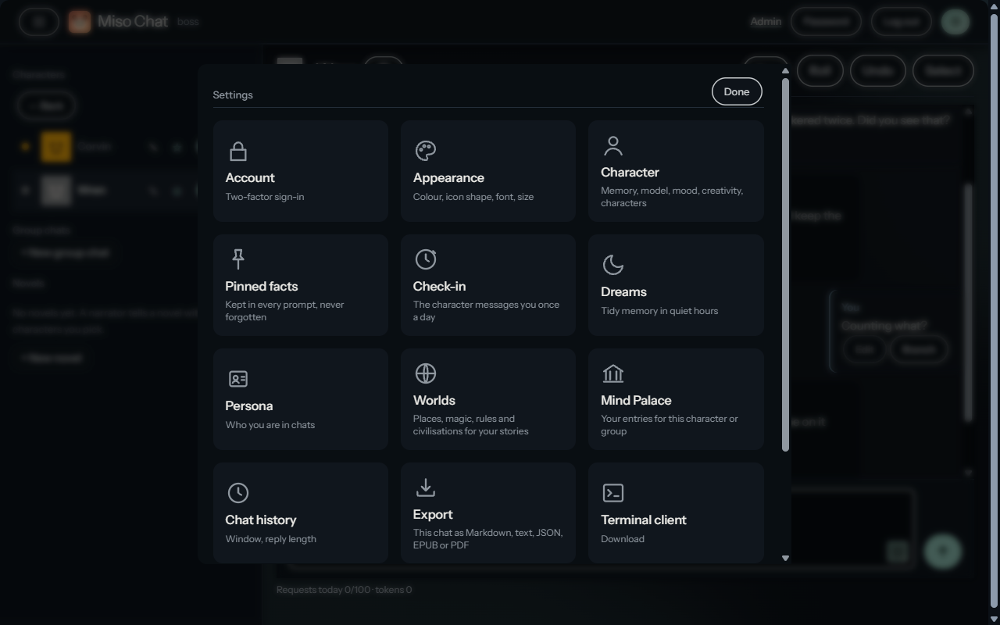 Moonlit: settings on desktop</td>
  </tr>
</table>

Moonlit, on a phone:

<table>
  <tr>
    <td align="center"> A chat</td>
    <td align="center">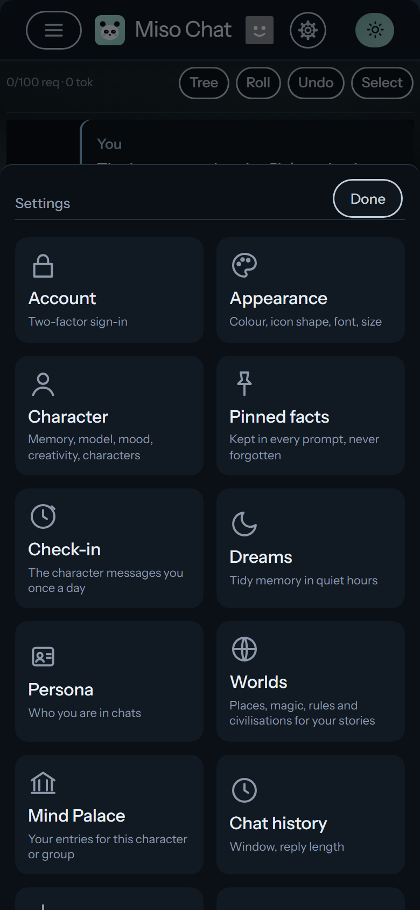 Settings</td>
    <td align="center"> Home</td>
  </tr>
</table>

## Requirements

- Python 3.11 or newer. The code was tested with Python 3.11 on Windows.
- A Gemini API key. Optional: a DeepSeek key, a local server with an OpenAI-style `/v1/chat/completions` endpoint, or the `claude` CLI signed in to an account.
- chafa, optional. Draws character pictures in the terminal client. See Chafa below.
- Tesseract OCR 5 or newer, optional. Only needed to draft a character from a screenshot or a scanned page. Text, Markdown, Word and text-layer PDF files work without it. See OCR below.

## Setup

    python -m venv .venv
    .venv\Scripts\activate        (Windows)
    source .venv/bin/activate     (macOS or Linux)
    pip install -r requirements.txt
    copy .env.example .env        (or: cp .env.example .env)

Open `.env` and set `GEMINI_API_KEY`. The app reads `.env` when it starts. A value that is already set in the environment wins over the file.

Gemini's free tier works for trying Miso Chat out. Get a key from Google AI Studio and set it as above. The free tier has low per-minute and per-day limits, so a busy chat or group chat can hit rate limits (HTTP 429). Some models have a small input-token cap on the free tier (Gemma 4 31B, for example), so pick a Gemini Flash or Flash-lite model if a turn fails. Not every model has been checked on the free tier, so test the models you plan to use.

### Tesseract on Windows

    winget install --id UB-Mannheim.TesseractOCR

The installer puts `tesseract.exe` in `C:\Program Files\Tesseract-OCR`, where the app looks for it. If it is somewhere else, set `MISO_TESSERACT` to the full path of the executable.

### Tesseract on Linux

The app runs the `tesseract` program, so install it with your package manager. On Debian and Ubuntu:

    sudo apt-get install -y tesseract-ocr tesseract-ocr-eng

On Fedora, `sudo dnf install tesseract tesseract-langpack-eng`. On Arch, `sudo pacman -S tesseract tesseract-data-eng`. Check the install with `tesseract --version`. If the program is not on the PATH, set `MISO_TESSERACT` to its full path.

The Python packages `pymupdf`, `python-docx` and `pillow` come from `requirements.txt`, so `pip install -r requirements.txt` covers them on both systems.

## Web app

    python -m uvicorn web.app:make_app --factory --host 127.0.0.1 --port 8000

Open http://127.0.0.1:8000 in a browser. On a new install the first account is `admin`, with a random one-time password printed once in the server log at first start. Sign in with it and change it before anything else. Create other accounts from the admin page.

Run the web app from the project folder, because character folders are read relative to it.

## Configuration

| Name | Purpose |
| --- | --- |
| `GEMINI_API_KEY` | Required for Gemini models. Read from `.env` or the environment. |
| `MISO_DATA_DIR` | Where `app.db`, `providers.json` and per-user chat state live. Default: `./data`. |
| `MISO_COOKIE_SECURE` | Set to `1` when the web app is served over HTTPS, so the login cookie is marked Secure. |
| `MISO_SECRET_KEY` | Created in `.env` on first start. Encrypts two-factor secrets. Keep a copy of `.env`. |

The older names `ROLEPLAY_DATA_DIR` and `ROLEPLAY_COOKIE_SECURE` are still read.

### Other providers

DeepSeek, a local OpenAI-style server and Claude Code are set up on the admin page under Model providers. Keys are write-only: the browser sees only a masked hint. They are stored in `data/providers.json`, with owner-only permissions where the system supports them.

Model ids for these providers carry a prefix: `deepseek:...`, `local:...` and `claude:...`. The Claude Code backend runs the `claude` CLI once per message, in print mode, with no tools.

### Models

The default fallback chain is set in `rp_core.py` (`ALLOWED_MODELS`, `DEFAULT_FALLBACKS`). Only ids in `ALLOWED_MODELS` are used. Provider model names change over time, so check them against the provider's documentation before you rely on them.

## Drafting a character from a file

In the new-character form, choose a file and select Read and draft. The app reads the text, sends it to the model with a standard drafting prompt, and fills in the name, card, headline, summary and tags. Nothing is saved until you press Create, so check the draft first.

Supported files:

- `.txt` and `.md` are read as they are.
- `.docx` is read with python-docx. Pictures inside it are OCR'd and their text is added.
- `.pdf` uses the text layer when there is one. A scanned page is rendered and OCR'd.
- `.png`, `.jpg`, `.jpeg` and `.webp` are OCR'd with Tesseract.

Files can be up to 10 MB. A PDF is read up to 20 pages, and a Word file up to 20 embedded pictures. The model only ever sees text. Pictures are never used as the profile picture or the chat background; upload those by hand.

OCR reads the text in a picture, so screenshots with plain, dark-on-light or light-on-dark text work best. Blurred or decorated fonts can misread. Check the draft.

## Mind Palace

The Mind Palace is keyword database searching for a character. Each entry has a title, one or more keys, and content. The entry joins the prompt only when one of its keys appears in the last six messages (or the entry's own scan depth, up to 30), including the one you are sending. Keys match whole words, ignoring case and accents. Common English endings are matched too: a key `cat` matches "cats", `love` matches "loved" and "loving", `stop` matches "stopped", and `city` matches "cities". A key `Vesper` still does not match "Vespertine". For an irregular form, put both in one key, such as `mouse|mice`. Each character has a budget, 3,000 characters by default and 500 to 12,000 in its settings. Up to 24 entries are matched in a turn. When the budget is full, the lowest-order entries are dropped.

Edit it in the character editor, under Mind Palace, once the character exists. It is saved as `palace.json` in the character folder and goes with the character on export. Matching uses no model calls.

An entry can also have secondary keys, combined with the main keys by AND or NOT logic: and any, and all, not any and not all. An entry can be always on, switched off without being deleted, and given its own scan depth and insertion order. When recursion is on for the character, a matched entry's text can trigger other entries, up to three steps deep.

### Automatic entries

A character can also add to its own Mind Palace. Automatic entries are off by default. Turn them on in Settings, Mind Palace, under Automatic entries. Every few turns (1 to 10, three by default) the model reads the recent chat and suggests up to three entries. Only the suggestion whose keys come up most in the last 30 messages is kept. The model can also correct an automatic entry when the chat changes what it says, up to two corrections per check.

The account keeps up to 20 automatic entries by default, 1 to 60 in the settings. When the limit is reached, the model must name one automatic entry to replace. Automatic entries are marked "Added automatically" in the list, and you can edit or delete them like any other entry. Your own entries are never changed by the model. Automatic entries apply to characters, not group chats, and each check is one model request counted against the account.

### Episodic memory

Earlier moments of a chat can come back when they become relevant again. When messages move out of the recent window, they are cut into short episodes of six messages, each with a few keys: the names and distinctive words in it. A later message that touches those keys brings the best matching episodes back into the prompt, up to three and about 1,500 characters.

When the keys find nothing, the new message is compared with the episodes by meaning, using an embedding from `gemini-embedding-001` at 256 dimensions. Episodes are embedded in one batch when the memory refresh cuts them, not on every message, and only the message being sent is embedded on a turn. Each message is shortened to 200 characters before it is embedded. An episode that failed to embed is still found by its keys.

Episodic memory is on by default. Each character can switch it off in Settings, Mind Palace, and an admin can switch it off for the whole server on the admin page. Turning it off stops recall and embedding, and the messages are not cut into episodes while it is off.

## Admin switches

On the admin page, under Settings, these switches apply to the whole app:

- Memory bank. On by default. Turning it off stops the memory being read, refreshed or shown, and also hides the Memory button.
- Mind Palace. Turning it off stops the palace being read or shown to anyone.
- Episodic memory. Turning it off stops recall and episode embedding for everyone.
- Autonomous dreaming. Off by default. See Dreams below.
- Mood. Off by default. Turning it on gives solo chats energy, affinity and an emotion, shown as bars in Settings. See Mood and relationship below.
- Relationship. Off by default. Turning it on gives solo chats affection and trust. See Mood and relationship below.
- Event memory. Off by default. The nightly dream writes the event graph, so leave this off unless dreaming is on too. See Memory below.
- Learned memory retention. Off by default. Scores automatic palace entries and episodes by whether they helped, and drops the ones that keep failing. Your own entries are never scored or dropped. See Saving tokens below.

The admin page also sets the dream frequency and the server's daily cap on dream model calls.

## Memory

A character has five kinds of memory, and each one has a different job.

- **Recent window.** The recent messages go to the model. The window is at least the size set under Settings, Chat history (25 messages for a 1:1 chat and 40 for a group by default) and up to nine messages more. Older messages in the window are clipped (see Clipping below), and the newest eight or more are sent whole. The window starts a whole number of ten-message steps before the clip boundary, so its first message stays put for ten turns at a time and the provider's prompt cache can reuse the part that has not changed.
- **Memory bank (`memory.md`).** Long-term facts about the people, places and history of the chat. It is refreshed every 20 messages from the last 30 messages. The refresh does not rewrite the file: the model replies with changes only (added facts, corrected lines and removed lines), and the app applies them. A fact the model does not mention is kept. The memory bank is limited to 20,000 characters.
- **Pinned facts.** Facts you pin in Settings, Pinned facts. They are sent with every reply, so the character never forgets them, and the refresh never changes them.
- **Running summary and episodes.** Messages are folded into a running summary as the clip boundary passes them, and each one is read to the same 550 characters the window keeps. Messages that have left the window are also cut into episodes that can be recalled (see Episodic memory under Mind Palace).
- **Event memory (`events.json`).** The nightly dream also writes dated events: who did what, the belief it left and what followed, plus a few evolving lines that change as the chat does. A later message brings back the events whose words overlap it. Capped at 200 events and 12 evolving lines, so it cannot grow without end. Off by default.

Automatic palace entries and dreams add to the memory over time. See Mind Palace and Dreams.

## Worlds

A world is the setting of your stories: its places, magic systems, rules, civilisations, factions, technology and other details. Each account keeps its own worlds, private to it, under Settings, Worlds. An account can keep up to 20. A novel or a chat uses its own world, the account's default world, or no world.

Each world has a name, a summary and seven sections. Write one entry per line in a section. Each entry can be up to 300 estimated tokens, the summary up to 250, and each section up to 1,500, except Other details, which is also 1,500. Every entry shows its own count under its box, and the section totals sit by the Save button. A save over a limit is refused with a message that says which entry or section is too long, so nothing is cut without your knowing.

A bullet (`-`, `*` or `•`) or a `[NEW]` tag at the start of a line is removed when the world is saved, because the prompt adds its own list marks. A number such as `1.` or `2)` is kept, so a numbered rule can still be cited. A title line such as `Expedition rules` is kept as the first item of its list.

The world is sent in the system prompt after the example messages, so it is the same on every turn. Its block is capped at 10,000 estimated tokens, and anything past the cap is left out at a whole entry.

## Mood and relationship

Two optional layers give a solo chat a continuous sense of how it is going. Both are admin switches, both are off by default, and both are shown as progress bars in the chat's Settings, with the value beside the bar.

Mood holds energy, affinity and an emotion that moves between calm, warm, tired and lonely. It has margins on the way back, so it does not flicker between two states. Energy only starts to fall once one unbroken stretch of talk passes the lite allowance, and it comes back only in silence, so free and lite accounts are never left exhausted. A character whose mood has gone quiet can send one check-in after a long silence.

Relationship holds affection and trust, each from 0 to 100, across five levels: stranger, acquaintance, friend, partner and married. Bonding events move them, with a three-exchange cooldown and a cap of six points a turn. A long stretch with no bonding event eases trust back, counted in exchanges rather than in time. Married comes only from a proposal at partner level with affection at 85 and trust at 75.

An admin can also set any of those five values by hand from the chat's Settings. The server checks for the admin flag on the request, so any other account is refused even if it calls the endpoint directly. This edits the admin's own row for that character.

Attitudes and moods are kept per character and account in the database. They are never sent as chat history; they join the newest user message as a short note for that turn.

## Home page

The home page at `/` shows every character as a card. A search box at the top matches the name, creator, headline and summary, ignoring case and accents. The filter button beside it opens the tag list, most common tags first. Selected tags stay at the top of the list, and a character must have every selected tag to show.

Once an account has chatted with characters, the home page shows up to four recommended characters that share tags with them. This uses message counts only and makes no model calls.

Avatars are squircles by default. Choose the circle option in the chat Settings.

The search button in the sidebar searches characters, worlds, Mind Palace entries and saved chats. It ignores case and accents, and every word in the query must match. A result opens the chat or the settings panel that owns the match.

## Chat branches

Each saved message has a Branch button. It copies the chat up to and including that message into a new branch and opens the copy. The chat you branched from is left as it was. The picker in the chat bar switches between the main chat and its branches, and Delete branch removes the open one.

A branch is a full copy of this account's memory, pinned facts, rolling summary and chat history. After the copy, the two chats change independently. A chat can have up to 12 branches. Branches work the same way for groups.

## Editing and deleting messages

Edit changes one message's wording, and Undo removes the last turn: your line and every reply after it. A trash button beside Regenerate removes the last message only.

Select, next to Undo, turns on pick mode. Every message gets a checkbox, and a bar offers All, None, Delete N and Cancel. Pick the messages you want gone and press Delete. Up to 500 go in one go. Deleting shifts everything after the removal, so the running summary and the episodes are cut back to the first deleted message and the later messages are read again under the right position. Deleting a reply also drops that exchange's saved swipe alternatives, which would otherwise describe a chat that no longer exists.

Neither edit, undo nor delete makes a model call, and none of them counts against your requests. They change only your own copy of the chat.

## Group chats

Any account can make a group chat from the sidebar. A group takes two to eight characters and is private to the account that made it. Other accounts cannot see, open or change it. An account can have up to 20 groups.

Each group turn starts with a director. The director reads the new message, the chat history, the summary, the memory and the member notes, then returns the speakers in the order they should answer. Each chosen member replies in that order, so a group can have one reply or several. The director uses the same model as the group members: whichever model the account has picked, or the first model in the chain if none is picked. If the director fails, one random member replies and the note in the chat says why. The director is used in the web app only.

After the director's picks, each reply may bring in one more speaker, up to two extra replies a turn, and no member gives more than two replies in a row. A group with one member skips the director, since there is only one choice. This keeps a group from answering with a single voice without letting one member take the turn over.

A group also has its own Mind Palace, one per account, kept in the same place as a solo chat's. Matched entries reach every member's reply and the director, so shared history lives in one place instead of in each member's card.

Per-member notes are set in the group dialog. Each note is private to the account and up to 500 characters. The director and the noted member both read it.

A group's picture and background are set by its owner in the group's Edit dialog. The picture shows beside the group in the sidebar, and the background sits behind its chat. Either can be removed there. Groups can be renamed, and their members and notes changed, without losing the picture or background.

## Branch tree

The Tree button in a chat opens the branch tree. It shows the main chat and each branch, with the branch each one was copied from. Each account sees the tree for its own chats. Admins can open any account's tree, but only to read it. Branches made before this release show under the main chat.

## Reply length

Admins set the reply length range on the admin page, from 10 to 4,000 tokens. Each account picks a target inside that range in its Settings. The default range is 50 to 1,000 tokens. Reasoning tokens are not counted. The target is a guide the model is asked to follow, not a hard cap.

## Token limits

Each account has three token limits: daily, weekly and monthly. Tokens used count against all three. The daily window resets at midnight Pacific, the weekly window on Monday at midnight Pacific, and the monthly window on the 1st at midnight Pacific. Admins have no tier and no cap unless one is set.

The monthly limit is the account's tier cap. By default that is 1M tokens for free, 10M for lite, 20M for standard and 100M for pro. The daily limit defaults to 10% of the monthly limit and the weekly limit to 20%. On the admin Tiers page, each tier's monthly cap and its daily and weekly percentages can be set, and the page shows the token amount each percentage gives.

On the admin Users page, each account shows the tokens used against each limit for today, this week and this month. The three boxes beside an account set its own daily, weekly and monthly limits. A blank box uses the tier figure, and the grey placeholder shows that figure. A number set on a user row applies to that account only.

Every limit is checked before each turn. A turn is blocked when any window is already at or over its limit, and the message names that window and when it resets. As before, a turn that starts under a limit can finish over it.

Each account can see its usage under Settings, Account, Token usage (View usage). The pop-up shows a progress bar and percentage for each window. The bar in the chat top bar shows whichever window is closest to its limit.

The admin stats page also splits the tokens the way providers bill them: cached input (a prompt-cache hit), uncached input and output, with the model time spent on each turn. That split starts with this version, so earlier days show 0 there. For tokens that went to the DeepSeek key it adds a cost estimate per model, in USD or CNY, from published DeepSeek rates per million tokens. The rates are mapped onto this server's DeepSeek model ids and leave out off-peak discounts, so read the figure as an estimate. To use your own rates, set the `deepseek_prices` setting to JSON in the same shape as the table in `web/pricing.py`.

## Saving tokens

Two optional features cut the prompt without changing what the chat is. Both are off by default and neither is needed to use the app.

### Near-lossless quenching

Quenching is a per-account preference in Settings, Account. It runs in two stages. The first is the same safe-word and whitespace cleaning the app already does: zero-width characters, runs of spaces, extra blank lines, HTML comments and decoration-only lines are removed, and no word is lost. The second reads only the older part of the history and removes the least informative sentences, the ones whose words are already common in that window.

The second stage only touches messages older than the clip boundary (see Clipping below). Every message you wrote is left whole, and so is every sentence shorter than six content words. So is any sentence with a figure, a quantity, a proper noun, a shouted word or a quotation. A removal is accepted only while at least 92 percent of the window's distinct content words survive and no more than 35 percent of its characters are gone, so the pass stops well before the text thins out. The context marker in Settings shows how much it saved.

This is near-lossless, not lossless. Wording is bounded, meaning is not proven. The result for a stretch of older messages is kept while those messages do not change, so the text sent stays the same between clip steps and the provider's prompt cache can reuse it.

Quenching is on by default in group chats, where an account has never set it. Solo chats keep it off until you switch it on, and an account that has switched it off keeps it off everywhere.

### Clipping

Messages older than the newest eight or more in the window are cut to about 550 characters, at a word break where one is near, and end with " ...". The boundary moves in steps of ten messages, so the same messages stay cut for ten turns at a time, which keeps the provider's prompt cache working. The running summary covers each message as it is clipped and reads it to the same 550 characters, so the model keeps the thread even where the detail is shortened.

Clipping is on by default. Turn it off under Settings, Chat history, and older messages are then sent in full.

The context marker above the chat shows the estimated size of the next prompt, the part the provider can reuse from its cache, the part that is new, and the tokens that quenching and clipping saved. These are estimates, about four characters per token.

### Memory retention

When the admin switch is on, memories the character wrote for itself are scored by what happened next. If your next message corrects the reply, the memories that were in the prompt lose credit; if you appreciate it or carry on with it, they gain credit. A memory that keeps failing to help decays faster than one that keeps helping, and it is dropped after two retrievals below the floor, or if it is never retrieved within 24 turns.

Only automatic Mind Palace entries and episodes are scored. Entries you wrote are never scored, never weighted and never dropped, and a learned score can only demote a memory, never lift it above something you wrote. The settings page lists the strongest items as bars under Memory retention.

Nothing here is trained. The score is a closed-form count of outcomes, computed on your own machine, with no model call.

## Scheduled check-ins

A character can message you once a day on its own. Check-ins are off by default. Open Settings, Check-in, choose a character's check-in and turn it on. You can have it at a set time, or at a random time within a range, in the time zone saved from your browser.

The check-in is written from the time since you last wrote, and it is saved in the chat marked as a check-in. Missed check-ins show as a red count on the character's sidebar button and home card. Opening the chat marks them read. If the server is not running at the chosen time, that day's check-in is skipped. Check-ins run inside the server, with no cron job. Each one is a model request counted against your account like any other message.

## Budget alerts

When a daily, weekly or monthly token window reaches 80% of its limit, the token meter in the top bar turns amber, and a warning appears above the chat, for example "You have 20% of your daily token budget left". At 100% the warning turns red and says new messages are blocked until the window resets. You can close the warning until the page is reloaded.

Admins can also set a webhook on the admin Limits page. The server posts a JSON message to it when an account reaches 80% or 100% of a window, once per window per level. The body has a `text` field and a `content` field, so Slack-style and Discord-style receivers can both read it.

## Dreams

Dreams are offline reflection. In a character's quiet hours the model reviews the character's recent memories and tidies them: it removes duplicate or wrong facts, adds links between facts under a Connections section, and drops automatic Mind Palace entries that repeat or contradict others. Pinned facts and your own palace entries are never changed.

Dreams are off by default. An admin turns them on, and sets how many days apart they run (1 to 30) and how many dream model calls the whole server may make each Pacific day (40 by default). An account turns them on for each character in Settings, Dreams, and sets the quiet hours, 02:00 to 06:00 by default, in the time zone saved from the browser.

When event memory is switched on, the same dream call also writes the event graph described under Memory. It costs no extra request.

A dream runs once in each window, and only after at least six new messages. When several characters are due, those that have never dreamed go first, and the rest run in random order. Dream calls are not counted against any user's requests or tokens. The server cap is the only limit on them, so set it to what you are willing to spend. Dreams run only while the server is running.

## Import and export

Admins can export a character as a zip file. The zip holds the card, icon, background, profile, creator, Mind Palace and example message files. Tick the history option to include this account's chat history and memory too.

A chat can be exported from Settings, Export, as Markdown, plain text, JSON, EPUB or PDF. The JSON file holds the character name, the export time and every message with its speaker, role, time, thinking text where it was kept, and the swipe position. The EPUB and PDF files hold the same chat, laid out for reading.

Admins can import a zip made by this app (format `miso-character`, version 1). An import never overwrites a character with the same name. Chat history from the zip is restored only into an account that has no history for that character yet. Zips are limited to 60 MB, and to 120 MB when unpacked.

## Importing a character card

In the new-character form, the Import card section reads a SillyTavern-style card: a `.json` file, or a `.png` with the card in its text, in the v1, v2 and v3 layouts. The name, card, scenario, summary, tags and lorebook fill the form for you to check. A PNG becomes the character's picture, and lorebook entries become Mind Palace entries once the character is created. Nothing is saved until you press Create. Example dialogue from the card is read into the character's Example messages section when it can be split into exchanges, and is left in the card text when it cannot. Opening messages are not imported, because Miso has no greeting message, and the import report says so.

## Chat backgrounds

Admins add backgrounds to a character in the character editor. A character can have up to 10. Each file is a PNG, JPEG or WebP picture up to 10 MB, and the app resizes it to at most 1,280 pixels on its longest side. Remove one with its Remove button.

- A chat picks one background at random each time it opens.
- Home cards and the info card cycle through the backgrounds at random. Each change waits 5 to 8 seconds, then fades to the next picture. Reduced-motion settings keep one still picture.
- A character with no backgrounds uses the default set for the look in use, in `web/static/defaults/`: blurred circles in each look's main colour (`moon-N` for Moonlit, `folio-N` for Soft Shadows, `classic-N` for Hyacinth; Dusk uses the full list). These cycle the same way.
- Under Settings, Appearance, two sliders set the background brightness (darker or lighter) and the chat bubble opacity. Each account keeps its own values.

A background is never read by OCR and is never used as the profile picture.

## Read aloud

A speaker button under a character reply reads it with the browser's speech synthesis. Press it again to stop. Under Settings, Voice & audio, choose a voice, rate, pitch and volume, test the result, and save a different voice for each character or group. Auto-read is off by default and reads new character replies as they arrive.

These settings are kept in the browser, not the account. The server sends no audio, so the browser or operating system must have voices installed. A browser with no voices shows a status message instead.

## Themes

Four looks ship with this version. **Moonlit** is the default. **Soft Shadows** is a reading view that sets the chat as a written page. **Dusk** is the calm end of the day: a slate ground, warm bone text and a soft periwinkle accent. **Hyacinth** is the 1.4.1 look, unchanged.

Choose one under Settings, Appearance, Theme. The choice applies to every page, login included, and takes effect at once with no reload and no lost chat state. It is kept per browser, next to the light/dark setting, not per account: two accounts on one browser share it, and a different browser starts on Moonlit.

- The light/dark button works in both looks, and the browser's toolbar colour follows it.
- The highlight colour still applies under both. Reset returns the default for whichever look is active.
- Hyacinth works by switching the redesign stylesheet off, so the plain `style.css` underneath shows through. That is why the layout, element ids and the JavaScript are the same either way.

## Characters and personas

Each character is a folder in the project root.

- `character.md` holds the card. The first line is `Character Persona: <Name>`, and a line `Colour: <name or #hex>` sets the colour used for the name badge and bubble.
- `context.md` (optional) holds memories, places and situations, and is added to the prompt.
- `icon.png` or `icon.jpg` (optional) is shown beside the name. Without one, the app shows a face in the character's colour.
- Names can hold any characters, such as `Dr. Fox: Night Form` or `Fox [Night]`. Windows folder names can't hold `< > : " / \ | ? *` or `%`, so those are percent-encoded in the folder name: `Dr. Fox: Night Form` lives in the folder `Dr. Fox%3A Night Form`. The name shown in chat comes from the folder name, or from the `Character Persona:` line when it is present.
- `memory.json` and `memory.md` are written by the app as the chat runs. Do not edit them while a chat is open.
- `creator.json` names the account that created the character. Characters without it are credited to `admin`.
- `profile.json` holds the public headline, summary and tags shown on the home page. It is written from the card when you use Auto-fill, and is never sent into the roleplay prompt.
- `backgrounds/` (optional) holds up to 10 pictures, one JPEG file each, added and removed in the editor. A chat, a home card and the info card use them. An older `background.jpg` still works.
- `palace.json` holds the Mind Palace entries.
- `examples.json` holds the example messages: up to 12 exchanges of a sample user line and the character's reply, written to show how the character speaks. They sit after the card in the system prompt and are never sent as chat history, so they do not appear in exports of the conversation. Edit them in the character editor under Example messages. A SillyTavern card's example dialogue is read into this section on import.

A group chat is a folder with a `group_config.json` that lists its members.

`personas.json` lists the folders you can speak as. A persona is never offered as a character to chat with.

This copy ships with no character or persona folders. Create a character folder, or import a character zip from the admin page.

## Word substitutions

An optional `substitutions.json` in the project root maps a word or phrase to a replacement, for example `{"old word": "new word"}`. Matching is whole-word and longest phrase first, and the replacement is applied to your messages before they are sent.

## Data and what is not included

`data/` holds the database, accounts, sessions, per-user chat history and memory, and provider keys. `.env` holds your Gemini key and `MISO_SECRET_KEY`. Both are git-ignored in `.gitignore`. Keep them out of any repository or shared folder. Backups include both, encrypted with the backup password.

Each account's memory, pinned facts, episodes, palace state, check-in and dream records live in its own folder under `data/users/`. None of it is part of the repository.

## Terminal client

`client/miso_remote.py` is a command-line chat client for a running server. It uses only the Python standard library. Character pictures need the optional chafa program. It lists the same characters, personas and groups as the web app and keeps the same chat history.

Run it with the server address:

    python client/miso_remote.py https://your-server.example

Options: `--username`, `--character` (open a character or group straight away) and `--persona`. Use an https address for any server other than localhost. The password is typed at a prompt and is never saved. If two-factor sign-in is on for the account, the client then asks for the 6-digit code from the authenticator app; the first sign-in with it required shows the key once to add to the app. Type `/help` inside the client for its commands.

It checks the server's version before it asks for a password. It works only with a server that has the same major and minor version: any 1.5.x client works with a 1.5.x server, but 1.4.1 and 1.5.0 do not work together. Download the client from the server's web app, which always matches that server.

Replies show quoted speech in green, `*italic*` and `**bold**`, and each character's reply sits in a box in that character's colour. Colours and italics need a terminal with 24-bit colour and italic support, such as Windows Terminal; other terminals show plain text.

Messages in the terminal client are separated by two blank lines, and the character's picture is drawn larger, up to 164 columns and 66 rows.

A chat opens with the character's picture, then the last two messages, and keeps its prompt at the bottom of the window while the chat scrolls above it. Under the prompt is one line: the model that answered, the clock, a bar for whichever token budget is closest to its limit, and an estimate of the next prompt's size that updates as you type. The estimate is about four characters per token, so treat it as a rough figure. On a narrow window the parts drop out from the left, the clock first.

The prompt is edited in place: the arrow keys, Home and End, Backspace, Delete, and Ctrl+A, E, U, K, W and L. Up and Down recall earlier lines. Ctrl+C clears the line, and on an empty line it closes the client, as Ctrl+D does. A pasted paragraph keeps its line breaks; the message is sent only when you press Enter.

When the client is not running in a terminal, as when its output is piped to a file, it falls back to a plain prompt and prints the status line before each message instead of redrawing it.

### Chafa for character pictures

The terminal client draws character pictures with `chafa`, an optional program. Install it, then check with `chafa --version`:

- Windows: `winget install --id hpjansson.Chafa -e`. If `chafa --version` still fails afterwards, add the folder that holds `chafa.exe` to PATH.
- Debian and Ubuntu: `sudo apt-get install -y chafa`
- Fedora: `sudo dnf install chafa`
- Arch: `sudo pacman -S chafa`
- macOS: `brew install chafa`

Without chafa the client still runs. Pictures are skipped, and `/portrait` says what is missing. Use `--no-image` to skip the picture when a chat opens.

The client refuses any redirect to a non-https address, so a password is never sent over plain http. To check the download, compare its SHA-256 with the value on the release page: `certutil -hashfile miso_remote.py SHA256` on Windows, or `sha256sum miso_remote.py` on Linux.

## Security

- Use the web app over HTTPS, or on a private network behind a private tunnel or VPN. The session cookie is marked Secure by default, and over HTTPS it is named `__Host-rp_session`, so no other subdomain can set or replace it. Sign-ins from 1.4.1 are signed out once by this update. Set `MISO_COOKIE_SECURE=0` only for plain-http testing on a private network, or sign-in will not work.
- Change the admin password on first login. A fresh install prints its random admin password once in the server log, so keep that log private until the password is changed. Use long, unique passwords for every account. Passwords need at least 10 characters, and common passwords, passwords that repeat the username and one- or two-character runs are refused.
- Failed sign-ins lock an account. 10 failures lock it for 15 minutes, then 15 failures for 30 minutes, 20 for an hour, 25 for two hours and 30 for four hours. Past 30, every 5 more wrong guesses lock it for four hours again, so there is no permanent lock. If no admin can sign in, run `python unlock_account.py USERNAME` on the server. The count resets only on a successful sign-in or an unlock. Separately, 15 consecutive wrong guesses from one address block that address for that account until an admin unlocks it. Other addresses are not affected. Behind Cloudflare the address comes from the `CF-Connecting-IP` header, which the server trusts only from localhost, so run cloudflared on the same machine as the web app.
- Passwords are stored as scrypt hashes at cost 2^16. Each check uses about 64 MB of memory for a moment.
- Two-factor sign-in uses an authenticator app. Any account can turn it on in Settings, and admins can require it on an account. Set-up happens on a page straight after the password, and nothing else is usable until it is finished. `MISO_SECRET_KEY` in `.env` is needed to read two-factor secrets and to restore a backup.
- Backups are encrypted with a password chosen by the first admin. Other admins can download a backup but cannot read it without that password. Nothing can recover a backup without its password.
- `rp_core.py` sets the safety thresholds in `safety_settings()` to `BLOCK_NONE` for sexual content, harassment, hate speech and dangerous content. Review them before you use the app, and decide what your provider allows. You are responsible for the content you generate and send.
- Costs are billed by each provider. Claude Code uses the quota of the account signed in to the `claude` CLI.

## Two-factor sign-in

Turn it on in Settings under Two-factor sign-in. Scan the QR code with an authenticator app such as Google Authenticator, Aegis or 1Password, or type the key in, then enter the 6-digit code. After that, every sign-in asks for the code after the password. The code changes every 30 seconds, and each code works once.

An admin can require it on an account from the admin users table. The account then sets it up on a set-up page straight after its password, and cannot use the app until the set-up is finished. The admin's own row has an enable 2FA button too. If an account loses its phone, an admin uses reset 2FA; the account then sets up a new code at its next sign-in.

The terminal client asks for the code too, and shows the key once at the first sign-in with it required.

## Backups

On the admin page, under Backups, an admin with two-factor sign-in on can make an encrypted backup. The first admin sets the backup password, at least 12 characters, before the first backup. A data backup holds the data folder, the server settings and `.env`. A full backup also holds the server code (the web and client folders). Backups are never scheduled. Make one when you need it.

To restore, run this in an empty folder, then install the requirements and start the app there:

    python restore_backup.py BACKUP_FILE TARGET_FOLDER

It asks for the backup password. Keep `MISO_SECRET_KEY` from the restored `.env`.

## Checks

This copy does not include the automated test suite. A basic static check is:

    pip install pyflakes
    python -m pyflakes rp_core.py llm_backends.py dotenv_loader.py web

## Known limits

- Usage caps and token budgets are checked before each turn. A turn that starts under budget can finish over it.
- OCR accuracy depends on the picture. Tested with clean rendered text, Tesseract read most characters correctly. Real phone screenshots with heavy blur, emoji or stylised fonts are harder, so check the draft.
- Drafts are one model call per file. A long file is cut at 30,000 characters before it is sent.
- Chat branches are full copies, so each one takes up disk space in proportion to the chat it copies.
- Home page recommendations are based on tags and message counts only. They do not read the character cards.
- Token counts in the context marker are estimates, about four characters per token.
- Gemma 4 31B on the free tier has a small input limit. Group chats do not use it.
- Episode embeddings use `gemini-embedding-001` at 256 dimensions. The similarity floor for a recall was chosen without live results and should be checked against them.
- Automatic palace entries, memory changes and dream changes are decided by the model. Review them in the Mind Palace and the memory bank.
- Dreams and check-ins run only while the server is running.
- Card import does not bring over opening messages.

## Credits and licences

The fonts in `web/static/fonts` are all licensed under the SIL Open Font License 1.1. Each licence text sits beside its files.

- Young Serif, a bundled display face: copyright 2023 The Young Serif Project Authors. See `web/static/fonts/OFL-youngserif.txt`.
- Instrument Sans, the Moonlit and Dusk interface face: copyright 2022 The Instrument Sans Project Authors. See `web/static/fonts/OFL-instrumentsans.txt`.
- Inter, the Hyacinth interface face and a chat font choice: copyright The Inter Project Authors. JetBrains Mono, the monospace choice: copyright JetBrains s.r.o. Both are in `web/static/fonts/OFL-inter-jetbrains-mono.txt`.
- Merriweather, a serif chat font choice: copyright 2024 The Merriweather Project Authors. See `web/static/fonts/OFL.txt`.
- Literata, a serif chat font choice: copyright 2017 The Literata Project Authors. See `web/static/fonts/OFL-literata.txt`.
- Atkinson Hyperlegible, a sans-serif chat font choice: copyright 2020 Braille Institute of America, Inc. See `web/static/fonts/OFL-atkinson-hyperlegible.txt`.
- Miso Chat is released under the MIT licence. See `LICENSE`. Copyright (c) 2026 wyn-cmd.
