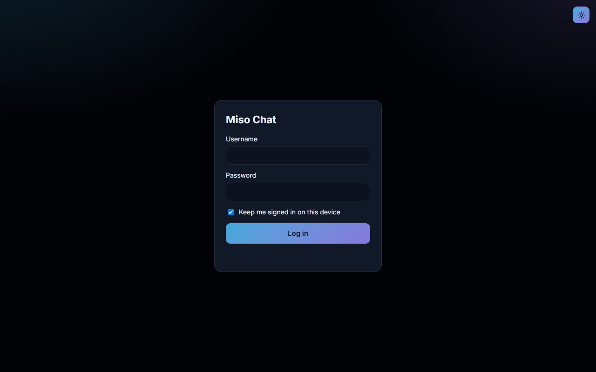
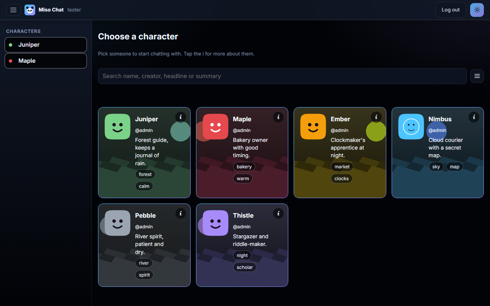
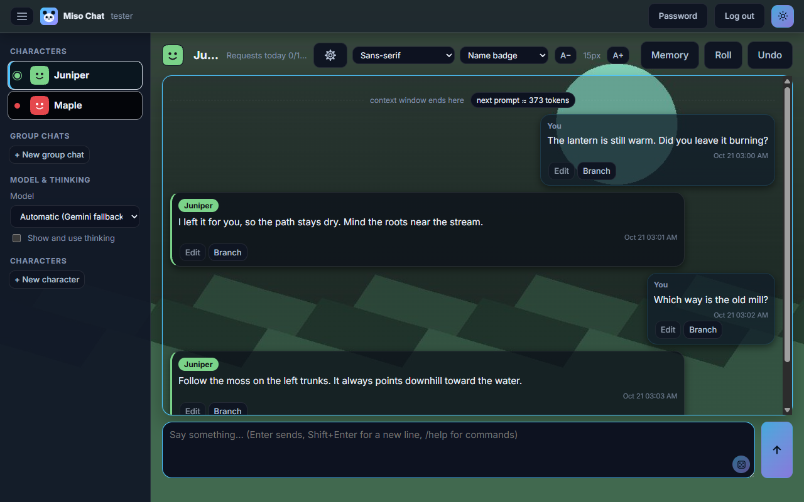
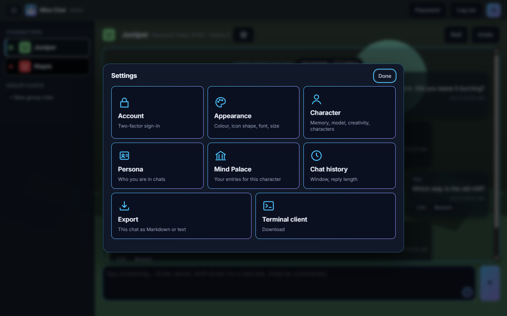
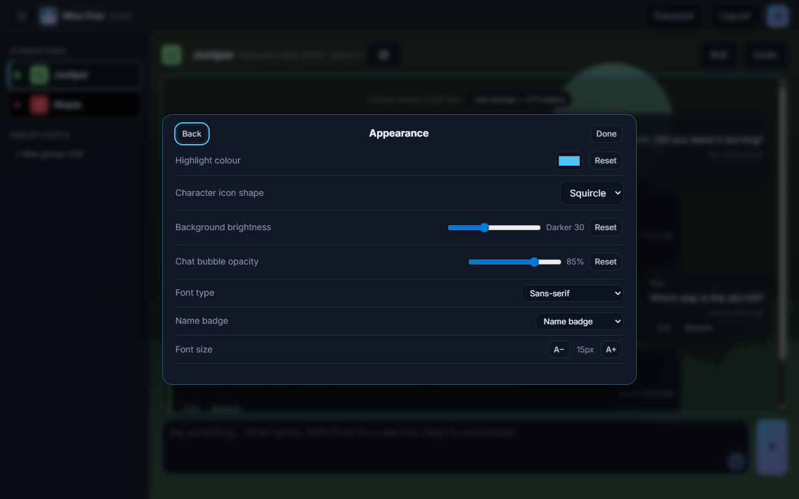
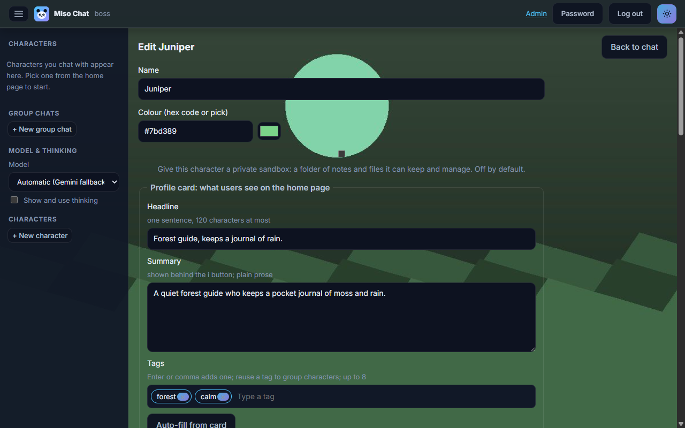
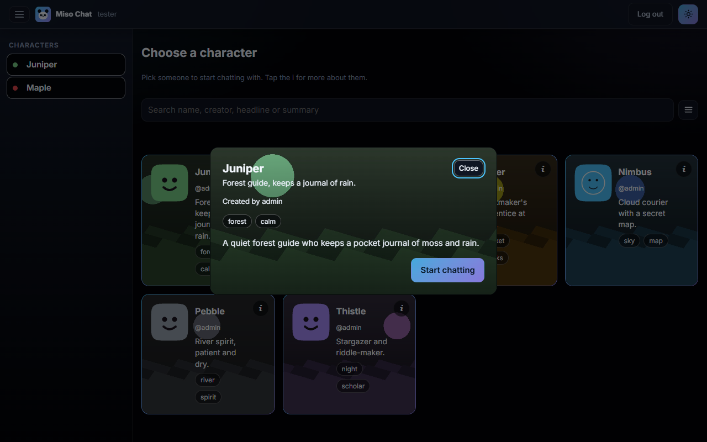
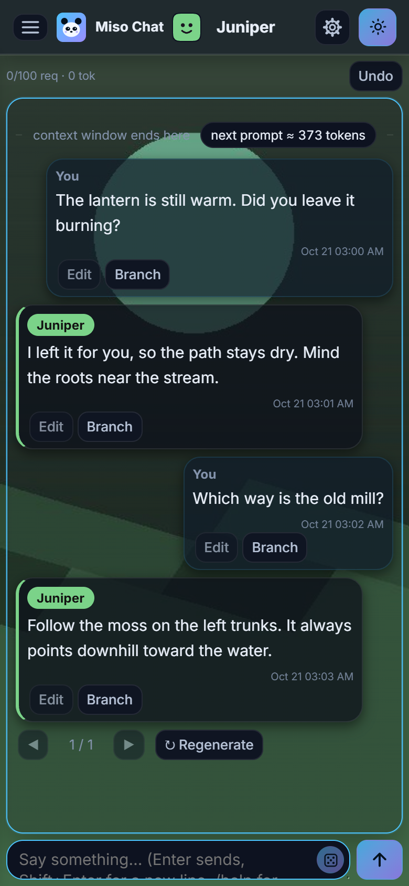
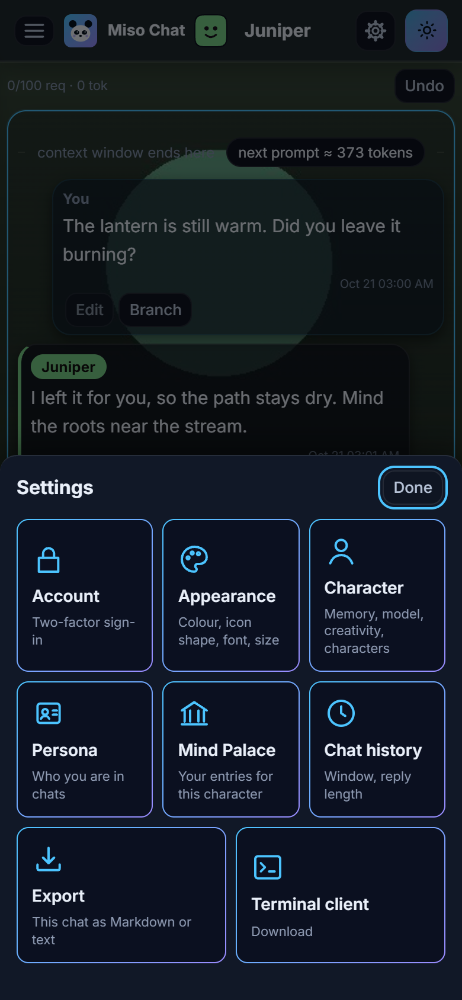

# Miso Chat

       

Miso Chat is a roleplay chat app that talks to Gemini, with optional DeepSeek, local OpenAI-style server and Claude Code backends. It is a FastAPI web app for several accounts: each account has its own chat history, memory and persona choice, and the admin manages accounts, usage caps, token budgets, providers, character cards and icons, and a stats page.

This is a personal project. It is built for use on one machine or a private network. It is not hardened for the open internet. See Security below.

## Screenshots

The pictures below use six made-up characters, with generated art and made-up chats. They show no real account, character or data.

## Requirements

- Python 3.11 or newer. The code was tested with Python 3.11 on Windows.
- A Gemini API key. Optional: a DeepSeek key, a local server with an OpenAI-style `/v1/chat/completions` endpoint, or the `claude` CLI signed in to an account.
- Tesseract OCR 5 or newer, optional. Only needed to draft a character from a screenshot or a scanned page. Text, Markdown, Word and text-layer PDF files work without it. See OCR below.

## Setup

    python -m venv .venv
    .venv\Scripts\activate        (Windows)
    source .venv/bin/activate     (macOS or Linux)
    pip install -r requirements.txt
    copy .env.example .env        (or: cp .env.example .env)

Open `.env` and set `GEMINI_API_KEY`. The app reads `.env` when it starts. A value that is already set in the environment wins over the file.

Gemini's free tier works for trying Miso Chat out. Get a key from Google AI Studio and set it as above. The free tier has low per-minute and per-day limits, so a busy chat or group chat can hit rate limits (HTTP 429). Some models have a small input-token cap on the free tier (Gemma 4 31B, for example), so pick a Gemini Flash or Flash-lite model if a turn fails. Not every model has been checked on the free tier, so test the models you plan to use.

### Tesseract on Windows

    winget install --id UB-Mannheim.TesseractOCR

The installer puts `tesseract.exe` in `C:\Program Files\Tesseract-OCR`, where the app looks for it. If it is somewhere else, set `MISO_TESSERACT` to the full path of the executable.

### Tesseract on Linux

The app runs the `tesseract` program, so install it with your package manager. On Debian and Ubuntu:

    sudo apt-get install -y tesseract-ocr tesseract-ocr-eng

On Fedora, `sudo dnf install tesseract tesseract-langpack-eng`. On Arch, `sudo pacman -S tesseract tesseract-data-eng`. Check the install with `tesseract --version`. If the program is not on the PATH, set `MISO_TESSERACT` to its full path.

The Python packages `pymupdf`, `python-docx` and `pillow` come from `requirements.txt`, so `pip install -r requirements.txt` covers them on both systems.

## Web app

    python -m uvicorn web.app:make_app --factory --host 127.0.0.1 --port 8000

Open http://127.0.0.1:8000 in a browser. The first login is `admin` with the password `admin`. The app asks you to change it before anything else. Create other accounts from the admin page.

Run the web app from the project folder, because character folders are read relative to it.

## Configuration

| Name | Purpose |
| --- | --- |
| `GEMINI_API_KEY` | Required for Gemini models. Read from `.env` or the environment. |
| `MISO_DATA_DIR` | Where `app.db`, `providers.json` and per-user chat state live. Default: `./data`. |
| `MISO_COOKIE_SECURE` | Set to `1` when the web app is served over HTTPS, so the login cookie is marked Secure. |
| `MISO_SECRET_KEY` | Created in `.env` on first start. Encrypts two-factor secrets. Keep a copy of `.env`. |

The older names `ROLEPLAY_DATA_DIR` and `ROLEPLAY_COOKIE_SECURE` are still read.

### Other providers

DeepSeek, a local OpenAI-style server and Claude Code are set up on the admin page under Model providers. Keys are write-only: the browser sees only a masked hint. They are stored in `data/providers.json`, with owner-only permissions where the system supports them.

Model ids for these providers carry a prefix: `deepseek:...`, `local:...` and `claude:...`. The Claude Code backend runs the `claude` CLI once per message, in print mode, with no tools.

### Models

The default fallback chain is set in `rp_core.py` (`ALLOWED_MODELS`, `DEFAULT_FALLBACKS`). Only ids in `ALLOWED_MODELS` are used. Provider model names change over time, so check them against the provider's documentation before you rely on them.

## Drafting a character from a file

In the new-character form, choose a file and select Read and draft. The app reads the text, sends it to the model with a standard drafting prompt, and fills in the name, card, headline, summary and tags. Nothing is saved until you press Create, so check the draft first.

Supported files:

- `.txt` and `.md` are read as they are.
- `.docx` is read with python-docx. Pictures inside it are OCR'd and their text is added.
- `.pdf` uses the text layer when there is one. A scanned page is rendered and OCR'd.
- `.png`, `.jpg`, `.jpeg` and `.webp` are OCR'd with Tesseract.

Files can be up to 10 MB. A PDF is read up to 20 pages, and a Word file up to 20 embedded pictures. The model only ever sees text. Pictures are never used as the profile picture or the chat background; upload those by hand.

OCR reads the text in a picture, so screenshots with plain, dark-on-light or light-on-dark text work best. Blurred or decorated fonts can misread. Check the draft.

## Mind Palace

The Mind Palace is keyword database searching for a character. Each entry has a title, one or more keys, and content. The entry joins the prompt only when one of its keys appears in the last six messages (or the entry's own scan depth, up to 30), including the one you are sending. Keys match whole words, ignoring case and accents. A key `Vesper` matches "Vesper" but not "Vespers", so list plurals as separate keys. Each character has a budget, 3,000 characters by default and 500 to 12,000 in its settings. Up to 24 entries are matched in a turn. When the budget is full, the lowest-order entries are dropped.

Edit it in the character editor, under Mind Palace, once the character exists. It is saved as `palace.json` in the character folder and goes with the character on export. Matching uses no model calls.

An entry can also have secondary keys, combined with the main keys by AND or NOT logic: and any, and all, not any and not all. An entry can be always on, switched off without being deleted, and given its own scan depth and insertion order. When recursion is on for the character, a matched entry's text can trigger other entries, up to three steps deep.

## Admin switches

On the admin page, under Settings, two switches apply to the whole app: memory bank and Mind Palace. Both are on by default. Turn one off and it is no longer read, refreshed or shown to users. Turning memory off also hides the Memory button. Any combination works, including both off.

## Home page

The home page at `/` shows every character as a card. A search box at the top matches the name, creator, headline and summary, ignoring case and accents. The filter button beside it opens the tag list, most common tags first. Selected tags stay at the top of the list, and a character must have every selected tag to show.

Once an account has chatted with characters, the home page shows up to four recommended characters that share tags with them. This uses message counts only and makes no model calls.

Avatars are squircles by default. Choose the circle option in the chat Settings.

## Chat branches

Each saved message has a Branch button. It copies the chat up to and including that message into a new branch and opens the copy. The chat you branched from is left as it was. The picker in the chat bar switches between the main chat and its branches, and Delete branch removes the open one.

A branch is a full copy of this account's memory, pinned facts, rolling summary and chat history. After the copy, the two chats change independently. A chat can have up to 12 branches. Branches work the same way for groups.

## Group chats

Any account can make a group chat from the sidebar. A group takes two to eight characters and is private to the account that made it. Other accounts cannot see, open or change it. An account can have up to 20 groups.

Each group turn starts with a director. The director reads the new message, the chat history, the summary, the memory and the member notes, then returns the speakers in the order they should answer. Each chosen member replies in that order, so a group can have one reply or several. The director uses the same model as the group members: whichever model the account has picked, or the first model in the chain if none is picked. If the director fails, one random member replies and the note in the chat says why. The director is used in the web app only.

Per-member notes are set in the group dialog. Each note is private to the account and up to 500 characters. The director and the noted member both read it.

## Branch tree

The Tree button in a chat opens the branch tree. It shows the main chat and each branch, with the branch each one was copied from. Each account sees the tree for its own chats. Admins can open any account's tree, but only to read it. Branches made before this release show under the main chat.

## Reply length

Admins set the reply length range on the admin page, from 10 to 4,000 tokens. Each account picks a target inside that range in its Settings. The default range is 50 to 1,000 tokens. Reasoning tokens are not counted. The target is a guide the model is asked to follow, not a hard cap.

## Import and export

Admins can export a character as a zip file. The zip holds the card, icon, background, profile, creator and Mind Palace files. Tick the history option to include this account's chat history and memory too.

Admins can import a zip made by this app (format `miso-character`, version 1). An import never overwrites a character with the same name. Chat history from the zip is restored only into an account that has no history for that character yet. Zips are limited to 60 MB, and to 120 MB when unpacked.

## Chat backgrounds

Admins add backgrounds to a character in the character editor. A character can have up to 10. Each file is a PNG, JPEG or WebP picture up to 10 MB, and the app resizes it to at most 1,280 pixels on its longest side. Remove one with its Remove button.

- A chat picks one background at random each time it opens.
- Home cards and the info card cycle through the backgrounds at random. Each change waits 5 to 8 seconds, then fades to the next picture. Reduced-motion settings keep one still picture.
- A character with no backgrounds uses the shared defaults in `web/static/defaults/`. These cycle the same way.
- Under Settings, Appearance, two sliders set the background brightness (darker or lighter) and the chat bubble opacity. Each account keeps its own values.

A background is never read by OCR and is never used as the profile picture.

## Characters and personas

Each character is a folder in the project root.

- `character.md` holds the card. The first line is `Character Persona: <Name>`, and a line `Colour: <name or #hex>` sets the colour used for the name badge and bubble.
- `context.md` (optional) holds memories, places and situations, and is added to the prompt.
- `icon.png` or `icon.jpg` (optional) is shown beside the name. Without one, the app shows a face in the character's colour.
- Names can hold any characters, such as `Dr. Fox: Night Form` or `Fox [Night]`. Windows folder names can't hold `< > : " / \ | ? *` or `%`, so those are percent-encoded in the folder name: `Dr. Fox: Night Form` lives in the folder `Dr. Fox%3A Night Form`. The name shown in chat comes from the folder name, or from the `Character Persona:` line when it is present.
- `memory.json` and `memory.md` are written by the app as the chat runs. Do not edit them while a chat is open.
- `creator.json` names the account that created the character. Characters without it are credited to `admin`.
- `profile.json` holds the public headline, summary and tags shown on the home page. It is written from the card when you use Auto-fill, and is never sent into the roleplay prompt.
- `backgrounds/` (optional) holds up to 10 pictures, one JPEG file each, added and removed in the editor. A chat, a home card and the info card use them. An older `background.jpg` still works.
- `palace.json` holds the Mind Palace entries.

A group chat is a folder with a `group_config.json` that lists its members.

`personas.json` lists the folders you can speak as. A persona is never offered as a character to chat with.

This copy ships with no character or persona folders. Create a character folder, or import a character zip from the admin page.

## Word substitutions

An optional `substitutions.json` in the project root maps a word or phrase to a replacement, for example `{"old word": "new word"}`. Matching is whole-word and longest phrase first, and the replacement is applied to your messages before they are sent.

## Data and what is not included

`data/` holds the database, accounts, sessions, per-user chat history and memory, and provider keys. `.env` holds your Gemini key and `MISO_SECRET_KEY`. Both are git-ignored in `.gitignore`. Keep them out of any repository or shared folder. Backups include both, encrypted with the backup password.

## Terminal client

`client/miso_remote.py` is a command-line chat client for a running server. It uses only the Python standard library. Character pictures need the optional chafa program. It lists the same characters, personas and groups as the web app and keeps the same chat history.

Run it with the server address:

    python client/miso_remote.py https://your-server.example

Options: `--username`, `--character` (open a character or group straight away) and `--persona`. Use an https address for any server other than localhost. The password is typed at a prompt and is never saved. If two-factor sign-in is on for the account, the client then asks for the 6-digit code from the authenticator app; the first sign-in with it required shows the key once to add to the app. Type `/help` inside the client for its commands.

It checks the server's version before it asks for a password. It works only with a server that has the same major and minor version: 1.3.0 and 1.3.4 work together, but 1.2.1 and 1.3.0 do not. Download the client from the server's web app, which always matches that server.

Replies show quoted speech in green, `*italic*` and `**bold**`, and each character's reply sits in a box in that character's colour. Colours and italics need a terminal with 24-bit colour and italic support, such as Windows Terminal; other terminals show plain text.

The client refuses any redirect to a non-https address, so a password is never sent over plain http. To check the download, compare its SHA-256 with the value on the release page: `certutil -hashfile miso_remote.py SHA256` on Windows, or `sha256sum miso_remote.py` on Linux.

## Security

- Use the web app over HTTPS, or on a private network behind a private tunnel or VPN. The session cookie is marked Secure by default. Set `MISO_COOKIE_SECURE=0` only for plain-http testing on a private network, or sign-in will not work.
- Change the admin password on first login. Use long, unique passwords for every account. Passwords need at least 10 characters.
- Failed sign-ins lock an account. 10 failures lock it for 15 minutes; 5 more lock it for 30 minutes, then 1, 2 and 4 hours. 35 failures with no successful sign-in lock it until an admin unlocks it on the admin page. If no admin can sign in, run `python unlock_account.py USERNAME` on the server. The count resets only on a successful sign-in or an unlock. Separately, 15 consecutive wrong guesses from one address block that address for that account until an admin unlocks it. Other addresses are not affected. Behind Cloudflare the address comes from the `CF-Connecting-IP` header, which the server trusts only from localhost, so run cloudflared on the same machine as the web app.
- Passwords are stored as scrypt hashes at cost 2^16. Each check uses about 64 MB of memory for a moment.
- Two-factor sign-in uses an authenticator app. Any account can turn it on in Settings, and admins can require it on an account. Set-up happens on a page straight after the password, and nothing else is usable until it is finished. `MISO_SECRET_KEY` in `.env` is needed to read two-factor secrets and to restore a backup.
- Backups are encrypted with a password chosen by the first admin. Other admins can download a backup but cannot read it without that password. Nothing can recover a backup without its password.
- `rp_core.py` sets the safety thresholds in `safety_settings()` to `BLOCK_NONE` for sexual content, harassment, hate speech and dangerous content. Review them before you use the app, and decide what your provider allows. You are responsible for the content you generate and send.
- Costs are billed by each provider. Claude Code uses the quota of the account signed in to the `claude` CLI.

## Two-factor sign-in

Turn it on in Settings under Two-factor sign-in. Scan the QR code with an authenticator app such as Google Authenticator, Aegis or 1Password, or type the key in, then enter the 6-digit code. After that, every sign-in asks for the code after the password. The code changes every 30 seconds, and each code works once.

An admin can require it on an account from the admin users table. The account then sets it up on a set-up page straight after its password, and cannot use the app until the set-up is finished. The admin's own row has an enable 2FA button too. If an account loses its phone, an admin uses reset 2FA; the account then sets up a new code at its next sign-in.

The terminal client asks for the code too, and shows the key once at the first sign-in with it required.

## Backups

On the admin page, under Backups, an admin with two-factor sign-in on can make an encrypted backup. The first admin sets the backup password, at least 12 characters, before the first backup. A data backup holds the data folder, the server settings and `.env`. A full backup also holds the server code (the web and client folders). Backups are never scheduled. Make one when you need it.

To restore, run this in an empty folder, then install the requirements and start the app there:

    python restore_backup.py BACKUP_FILE TARGET_FOLDER

It asks for the backup password. Keep `MISO_SECRET_KEY` from the restored `.env`.

## Checks

This copy does not include the automated test suite. A basic static check is:

    pip install pyflakes
    python -m pyflakes rp_core.py llm_backends.py dotenv_loader.py web

## Known limits

- Usage caps and token budgets are checked before each turn. A turn that starts under budget can finish over it.
- OCR accuracy depends on the picture. Tested with clean rendered text, Tesseract read most characters correctly. Real phone screenshots with heavy blur, emoji or stylised fonts are harder, so check the draft.
- Drafts are one model call per file. A long file is cut at 30,000 characters before it is sent.
- Chat branches are full copies, so each one takes up disk space in proportion to the chat it copies.
- Home page recommendations are based on tags and message counts only. They do not read the character cards.
- Token counts in the context marker are estimates, about four characters per token.
- Gemma 4 31B on the free tier has a small input limit. Group chats do not use it.

## Credits and licences

- Merriweather, in `web/static/fonts`, is licensed under the SIL Open Font License 1.1. See `web/static/fonts/OFL.txt`.
- Miso Chat is released under the MIT licence. See `LICENSE`. Copyright (c) 2026 wyn-cmd.
